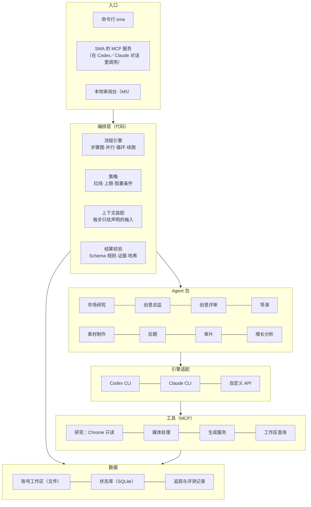

# SMA 总体设计

- 状态：草案 v0.1，待审阅
- 日期：2026-10-15
- 范围：SMA（Social Media Automation），内容创作垂直领域的 agent harness

## 1. 一句话

用户说一句"今天做一条视频"，SMA 调度一组专业 Agent：先找被市场验证过的机会，再用多种方法出创意、独立盲评、做制作方案、生成素材、剪辑、实际审片并返工，最后交付完整内容包。中途不需要用户确认，只在真正卡住时发阻塞报告。

## 2. 背景

前身是 AI-SMA（v0.x）：一套 Markdown 规则和角色说明，运行在 Claude Code、Codex 这类客户端里。实际使用暴露了四个结构性问题：

1. **没有自己的运行时。** 角色只是提示文件，循环、工具调用、子 Agent 和状态都依赖客户端。
2. **约束靠提示词。** 一次停更账号重启的测试里，Agent 把用户的一句话理解错了，直接写成定位，后面的目标、对标、选题全部跑偏；其他项目的信息也经客户端全局记忆进入了项目。
3. **每个账号复制一整套系统。** 规则和工具跟着模板复制，升级要逐个账号同步。
4. **交接没有类型、运行没有追踪、改动没有评测。** 无法判断一次改动是变好还是变坏。

业内的通行说法是"Agent = 模型 + Harness"：harness 是包在模型外面、让它能可靠干活的那层软件，负责运行循环、工具、上下文、状态、编排、策略、可观测和评测。SMA 要做的是内容创作领域的 harness。

## 3. 目标与非目标

**目标**

| 编号 | 目标 | 怎么算达到 |
|---|---|---|
| G1 | 一句话端到端 | 一句话任务从调研到交付，中途确认 0 次，只有阻塞报告 |
| G2 | 创意有市场依据 | 每个创意都能追到爆款证据；评审和出方案的 Agent 相互独立 |
| G3 | 约束由程序执行 | 不发布、账号隔离、交付只增不改、付费任务不重复提交，都在代码或工具层拦住 |
| G4 | 引擎和模型可替换 | 开发期以 Codex CLI 为主引擎，Claude CLI、自定义 API 可以插入；按角色混用模型 |
| G5 | 可观测、可续跑 | 每次运行都有完整记录，中断后从断点继续，可以回放和比较 |
| G6 | 可评测、会进化 | 每个 Agent 包和流程都有评测集；发布后的真实数据会改变之后的决策 |
| G7 | 装一次，管多个账号 | 系统只装一份，账号只是数据工作区；升级不需要逐个账号复制 |

**非目标**

| 编号 | 不做什么 |
|---|---|
| N1 | 通用 harness：不做编程、办公等通用 Agent |
| N2 | 平台写操作：发布、评论、私信、点赞、关注永远由用户自己完成 |
| N3 | 多用户在线平台：后期再议 |
| N4 | 自写底层模型循环：先复用 Codex、Claude，接口留口子 |
| N5 | 现阶段的前端：M5 才做本地审阅台 |

## 4. 已定决策

| 决策 | 内容 | 记录 |
|---|---|---|
| 使用者 | 先自用，架构按"能发给别人装"设计；多用户在线很后期 | — |
| 引擎 | 复用现成的 Agent 引擎：开发测试用 Codex CLI；后期支持本机 Codex 登录和自定义 API；Claude CLI 作为第二引擎 | [ADR-0001](../adr/0001-reuse-agent-engines.md) |
| 模型 | 按 Agent 包混用；评审类角色默认用和出方案的角色不同的模型家族 | [ADR-0001](../adr/0001-reuse-agent-engines.md) |
| 编排 | 总控是代码：流程、上限、策略和阻塞判断由程序执行；规划 Agent 只提议 | [ADR-0009](../adr/0009-orchestrator-is-code.md) |
| 语言 | 核心用 Python；以后的前端单独用 TypeScript | [ADR-0002](../adr/0002-python-core.md) |
| 领域 | 内容创作垂直 harness | — |
| 仓库 | 新仓库从零写；AI-SMA 保留为旧版模板，只迁移有价值的设计和资产 | — |
| 第一个场景 | 一句话 → 调研 → 3 路创意 → 盲评 → 选定创意和制作方案，不含付费生成 | — |

## 5. 总体架构



| 层 | 职责 | 详细规范 |
|---|---|---|
| 入口 | 命令行；SMA 自己的 MCP 服务；以后的本地界面。三者共用同一套状态 | 本文第 8 节 |
| 编排层 | 按流程定义调度步骤、并行和循环；执行策略和上限；装配每一步的上下文；校验每一步的产物；断点续跑 | [03 流程与编排](03-workflow.md) |
| Agent 包 | 每个专业角色一个包：身份和方法、模型和引擎偏好、权限和工具、输入输出合同、知识、评测集 | [01 Agent 包规范](01-agent-package.md) |
| 交接合同 | 角色之间只传有 Schema 的产物，带证据引用和内容哈希 | [02 交接合同](02-contracts.md) |
| 引擎适配 | 统一接口，背后是 Codex CLI、Claude CLI、自定义 API；负责把一个步骤翻译成一次引擎调用 | [04 引擎适配](04-engines.md) |
| 工具与策略 | SMA 自己的 MCP 服务；红线落在工具能力和沙箱上 | [05 工具与策略](05-tools-and-policy.md) |
| 数据 | 账号工作区只放这个账号的数据；状态库记录运行、步骤、产物、外部任务 | [06 工作区与数据](06-workspace-and-data.md) |
| 追踪与评测 | 每一步的输入、输出、事件、耗时、用量；包级、流程级评测和真实数据回流 | [07 追踪与评测](07-observability-and-evals.md) |

## 6. 一次运行怎么走

第一个场景 `ideate`（详见 [03 流程与编排](03-workflow.md) 第 9 节）：

```text
sma run "今天做一条视频" --account <账号工作区>
```

1. **检查前提。** 读账号配置；定位没确认就生成阻塞报告并停止，这是全流程唯一的人工关口。
2. **调研。** 市场研究分两路并行（爆款与对标、热点与评论），增长分析读本账号的近期表现；编排层合并成一份机会简报。
3. **创意。** 3 个创意总监实例并行，各用一种方法（同赛道机制借鉴、跨赛道迁移或热点重组、原创发散）。
4. **盲评。** 编排层去掉候选的方法标签和来源，交给创意评审；评审默认换一个模型家族。不过线就带着评审意见回到第 3 步，最多 2 轮。
5. **方案。** 导演把选中的创意做成制作方案和镜头表。
6. **交付。** 输出选定的创意、制作方案和依据卡；每一步都有记录，可以用 `sma runs show` 查看。

## 7. 设计原则

| 编号 | 原则 | 含义 |
|---|---|---|
| P1 | 总控是代码 | 流程、上限、策略、阻塞判断由代码执行；需要临场判断的地方（例如研究方向）交给规划 Agent 提议，由代码校验后采用 |
| P2 | 每一步上下文干净 | 一个步骤只拿到声明的输入产物，不继承前面的聊天记录；输出必须通过 Schema |
| P3 | Agent 只交产物 | Agent 不直接写账号工作区，只在自己的步骤目录里产出；由编排层校验后入库或打包 |
| P4 | 红线即能力 | 没有发布工具；浏览器工具只有只读操作；写权限由沙箱和步骤目录决定 |
| P5 | 证据绑定版本 | 产物、确认、检查都用内容哈希绑定；内容改了，确认和检查就失效（沿用 AI-SMA 的做法） |
| P6 | 独立评审 | 评审和出方案的角色不同包、默认不同模型家族、盲评 |
| P7 | 账号即数据 | 一个账号一个工作区；系统代码、Agent 包、技能都不复制进账号 |
| P8 | 引擎可替换 | 引擎差异封装在适配层；Agent 包只声明需求，不写死引擎细节 |
| P9 | 先评测再改动 | 改 Agent 包、模型或提示词，先用同一套评测集比较 |

## 8. 入口

| 入口 | 用途 | 阶段 |
|---|---|---|
| `sma run` | 一句话任务，按流程跑完或停在阻塞报告 | M1 |
| `sma runs list／show／resume` | 查看运行记录、产物和事件；从断点继续 | M1 |
| `sma strategy confirm` | 本人确认定位，记录原话并绑定定位文件的哈希 | M1 |
| `sma eval` | 运行某个 Agent 包或某个流程的评测集 | M1 |
| `sma package new／lint` | 新建、检查 Agent 包 | M1 |
| `sma doctor` | 检查引擎、登录、工具、技能是否齐全 | M1 |
| `sma account init／register／list` | 新建、登记账号工作区 | M1 |
| `sma account import` | 从 AI-SMA 的账号项目导入 | M4 |
| SMA 的 MCP 服务 | 在 Codex 或 Claude 的对话里调用 `run_task`、`get_run`、`get_artifact` | M3 |
| 本地审阅台 | 看板、产物和成片审阅、阻塞处理 | M5 |

## 9. 仓库结构（计划）

```text
SMA/
├── README.md
├── AGENTS.md                 给开发本仓库的 agent 的约定
├── docs/
│   ├── design/               设计文档（本目录）
│   └── adr/                  决策记录
├── src/sma/
│   ├── cli/                  命令行
│   ├── orchestrator/         流程引擎、状态机、上下文装配
│   ├── engines/              Codex、Claude、API 适配
│   ├── contracts/            产物模型和校验
│   ├── policy/               红线、上限、阻塞条件
│   ├── state/                SQLite 状态库
│   ├── tracing/              事件和步骤记录
│   └── evals/                评测运行器
├── agents/<id>/              Agent 包
├── workflows/                流程定义
├── schemas/                  产物的 JSON Schema
├── mcp/                      SMA 自己的 MCP 服务
├── evals/                    流程级评测场景
├── tests/
└── pyproject.toml
```

## 10. 技术选型

| 方面 | 选择 | 理由 |
|---|---|---|
| 语言与环境 | Python 3.11+，用 uv 管理 | 媒体处理、转写、数据分析生态好；引擎都以子进程调用，不受语言限制 |
| 产物校验 | JSON Schema（jsonschema） | 和引擎的结构化输出用同一份 Schema |
| 状态 | SQLite（标准库）加文件 | 单机、零运维、可备份；大文件只存路径和哈希 |
| MCP 服务 | 官方 Python SDK | 标准协议，Codex、Claude 都能接 |
| 浏览器研究 | Playwright 连本机 Chrome 的账号专用资料 | 只暴露只读操作；登录态由用户自己完成 |
| 媒体 | ffmpeg／ffprobe；转写可选 faster-whisper | 本地处理，不依赖外部服务 |
| 测试 | pytest | 通用 |

依赖尽量少：命令行用 typer 和 rich；配置和包声明用 pydantic 校验，内部记录用 dataclass。

## 11. 从 AI-SMA 迁移什么

| AI-SMA 里的 | 在 SMA 里变成 |
|---|---|
| 红线 | 策略层和工具能力（[05](05-tools-and-policy.md)） |
| SOP | 流程定义和 Agent 包的方法说明 |
| 8 个角色说明 | 8 个 Agent 包的指令 |
| 交接格式（合同.md） | `schemas/` 里的 JSON Schema |
| 任务工具的"确认和检查绑定文件哈希" | 状态库和校验层的同一机制 |
| 测试用例 | 流程级评测场景 |
| 共享技能 | 按名字引用，不复制 |
| 停更账号重启的失败复盘 | 回归评测：方向变更必须复述确认 |

AI-SMA 的账号项目（规范、账号数据、爆款库）在 M4 由导入命令转成 SMA 工作区。

## 12. 里程碑

| 里程碑 | 内容 | 验收 |
|---|---|---|
| M0 设计 | 本文档和分项规范、决策记录 | 本人审阅通过 |
| M1 骨架 | 命令行、Codex 引擎、状态库、追踪；账号工作区和定位确认；2 个 Agent 包（市场研究、创意总监），市场研究先用引擎自带的网页搜索和本人提供的资料；结构化输出和校验；1 个包级评测 | 一句话跑出合格的机会简报和创意候选，产物通过 Schema，运行可查看、可续跑 |
| M2 创意流程 | 研究工具（Chrome 只读）；创意评审盲评和返工循环；导演；规划 Agent；增长分析的账号基线；`sma-workspace` 服务 | `ideate` 端到端，中途 0 次确认；停更账号重启场景通过回归评测 |
| M3 制作与审片 | 素材制作、后期、审片；生成服务和媒体工具；返工循环；打包交付；SMA 的 MCP 服务 | 一句话视频场景：完整内容包、真实审片、可修问题自动返工 |
| M4 回流与导入 | 增长分析和经验更新；从 AI-SMA 导入账号；Claude 引擎 | 下一次任务能说明哪些真实数据影响了决定 |
| M5 审阅台 | 本地 Web 界面：看板、产物、成片、阻塞处理 | 不开终端也能完成一次任务和验收 |
| 之后 | 自定义 API 完善、安装包、发给别人用 | — |

## 13. 风险与未决问题

| 编号 | 问题 | 处理 |
|---|---|---|
| R1 | 一次运行十几次引擎调用，订阅额度消耗大 | M1 记录每步用量；可配置并行上限和模型档位 |
| R2 | `--ignore-user-config` 下，自定义提供方、MCP 服务、技能能否全部用命令行参数传入 | M1 第一项实测 |
| R3 | 读权限隔离：Codex 沙箱主要限制写，读其他文件夹拦不住 | 步骤在独立目录运行；只给本账号路径；运行后扫描产物里的其他账号名称（沿用 AI-SMA 的隔离检查） |
| R4 | 浏览器自动化的平台风控和登录态失效 | 只读、限速、账号专用资料；失效时发阻塞报告，由用户登录 |
| R5 | Claude CLI 需要单独登录或 API Key | M4 再接；之前用 Codex 内不同模型或自定义 API 做异家族评审 |
| R6 | 拆解他人作品的版权和平台规则 | 只抽帧、转写用于分析，不进交付；"抄结构不抄表达"写进评审 |
| R7 | 仓库是公开的 | 暂不加许可证（默认保留所有权利）；开源与否、用什么许可，在发给别人用之前再定 |
| R8 | 中文目录名：交付、发布内容、固定资产 | 用户可见的三个目录保留中文；代码、包 id、Schema 一律英文 |

## 14. 文档导航

| 文档 | 内容 |
|---|---|
| [01 Agent 包规范](01-agent-package.md) | 包的目录、`agent.yaml` 字段、指令写法、技能引用、评测集 |
| [02 交接合同](02-contracts.md) | 产物的公共字段、类型清单、校验层级、版本 |
| [03 流程与编排](03-workflow.md) | 流程定义格式、运行状态机、并行和循环、阻塞报告、`ideate` 流程 |
| [04 引擎适配](04-engines.md) | 引擎接口、Codex 和 Claude 的参数映射、登录与自定义 API、模型路由、上下文装配 |
| [05 工具与策略](05-tools-and-policy.md) | SMA 的 MCP 服务、红线的执行方式、密钥、隔离 |
| [06 工作区与数据](06-workspace-and-data.md) | 账号工作区结构、状态库表、账号级记忆、导入 |
| [07 追踪与评测](07-observability-and-evals.md) | 运行记录、评测层级、回归流程、核心指标 |
| [决策记录](../adr/README.md) | 每个关键决策的背景、选择和代价 |
