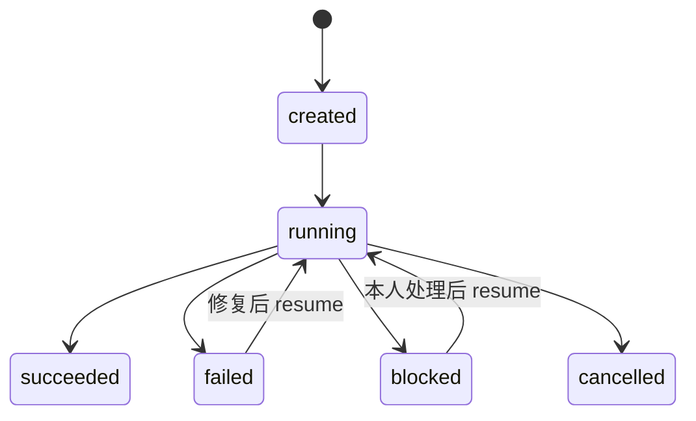

# 03 流程与编排

- 状态：草案 v0.1
- 相关：[00 总体设计](00-overview.md)、[02 交接合同](02-contracts.md)、[04 引擎适配](04-engines.md)、[ADR-0009](../adr/0009-orchestrator-is-code.md)

## 1. 编排层做什么

加载流程定义，按步骤图调度；执行策略和上限；给每一步装配上下文、调用引擎；校验产物；记录状态和追踪；处理失败、循环和阻塞；中断后续跑。

总控是代码，不是一个 LLM 角色（原则 P1）。需要临场判断的地方，例如这次研究走哪几个方向，由规划 Agent 提议，代码校验后采用。

## 2. 流程定义

流程用 YAML 定义，放在仓库的 `workflows/`。

| 概念 | 说明 |
|---|---|
| `step` | 一个步骤：由某个 Agent 包执行（`agent`），或由代码执行（`code`） |
| `needs` | 依赖的步骤，全部成功后才就绪 |
| `foreach` | 按参数列表展开成多个并行实例，实例 id 形如 `ideation[a]` |
| `inputs` | 本步骤要的产物：来自哪个步骤、什么类型、是否必需 |
| `outputs` | 本步骤交出的产物类型 |
| `transform` | 交给 Agent 前对输入做的处理，例如盲化（去掉方法标签和来源） |
| `gate` | 机器检查，例如评审是否过线 |
| `loop` | 返工循环：满足条件时带着意见回到某一步，有轮数上限 |
| `on_fail` | 失败后怎么办：重试、阻塞或使整次运行失败 |
| `checkpoint` | 只在 checkpoints 模式生效：在这里暂停，等本人批准 |

```yaml
id: ideate
version: 1
preconditions: [positioning_confirmed]
steps:
  ideation:
    agent: creative-director
    needs: [merge]
    foreach:
      param: method
      from: plan.ideation_methods        # 规划 Agent 的提议，校验不过就用默认值
      default: [mechanism-borrow, cross-domain, original]
    inputs:
      - { from: merge, type: opportunity-brief }
      - { from: library, type: viral-reference, select: top_by_outlier, limit: 12 }
    outputs: [idea-candidates]
  review:
    agent: creative-critic
    needs: [ideation]
    transform: [blind]
    inputs:
      - { from: ideation, type: idea-candidates, all: true }
      - { from: merge, type: opportunity-brief }
    outputs: [idea-review]
    gate: review_passed
    loop: { when: "verdict == 'revise'", back_to: ideation, carry: required_changes, max_rounds: 2 }
    on_fail: { after_rounds: block, reason: rounds-exhausted }
    checkpoint: true
```

## 3. 状态机



| 对象 | 状态 |
|---|---|
| 运行 | `created`、`running`、`blocked`、`succeeded`、`failed`、`cancelled` |
| 步骤 | `pending`、`ready`、`running`、`succeeded`、`failed`、`blocked`、`skipped`；另记尝试次数 |

状态存在状态库（[06](06-workspace-and-data.md) 第 5 节），每次转换都写一条记录。

## 4. 调度

- 依赖全部成功的步骤进入就绪；同时运行的步骤不超过账号配置的 `max_parallel_steps`（默认 3）。
- `foreach` 的实例并行；汇合步骤等所有实例结束。
- 每一步的超时取自包的 `limits.timeout_s`；`sma runs cancel` 会中止正在运行的引擎进程。
- 一个步骤的输入由引用和哈希固定；同样的输入重跑，产生新的尝试记录，不覆盖旧的。

## 5. 失败、重试与续跑

| 情况 | 处理 |
|---|---|
| 引擎退出码非零、超时 | 退避重试，最多到 `limits.max_attempts` |
| 输出没过校验 | 带着校验错误修复重试（[02](02-contracts.md) 第 5 节），计入同一个尝试上限 |
| 重试用完 | 按 `on_fail`：使运行失败，或生成阻塞报告并转为 `blocked` |
| 识别出登录失效、缺 Key、缺授权 | 直接阻塞，`reason` 写明，不反复重试 |
| 进程中断 | 续跑时，已成功的步骤按哈希复用；中断时正在运行的步骤重跑 |
| 付费外部任务 | 提交前查任务台账（按幂等键）；续跑时先查询原任务状态，不重复提交 |

续跑命令：`sma runs resume <运行>`。

## 6. 人的参与

- **full 模式（默认）**：运行中不找本人确认，只在 [02](02-contracts.md) 第 3 节列的六种原因下发阻塞报告。
- **checkpoints 模式**：在声明了 `checkpoint` 的步骤后暂停，等 `sma runs approve <运行> <步骤> --note "原话"`。
- **唯一的全局关口是定位确认。** `sma strategy confirm --note "原话"` 记录本人的确认，并绑定定位文件的哈希；文件改了，确认就失效，`ideate` 的前提检查不通过。
- **方向调整不进创意流程。** 本人的任务原话涉及转型、放弃、换方向时，规划 Agent 标记出来，`ideate` 不启动，改走 `strategy` 流程（第 10 节）：先按"保留／放弃／新增"复述，等本人确认。这条来自 AI-SMA 停更账号测试的失败教训。

## 7. 上下文装配

每一步交给引擎的内容只有这些，不带前面步骤的聊天记录：

| 部分 | 来源 |
|---|---|
| 角色指令 | 包的 `instructions.md` |
| 策略摘要 | 编排层统一生成：红线、本步骤的权限、交付要求 |
| 技能 | 包声明的技能，由引擎原生加载 |
| 知识 | 包的 `knowledge/` 里声明的文件 |
| 账号经验 | `memory.read` 为真时，账号工作区里该角色的经验 |
| 输入产物 | 按 `inputs` 选取，经过 `transform`（例如盲化） |
| 任务 | 本人的原话，加上本步骤的参数（例如创意方法） |

输入太大时按规则截取，例如爆款条目只取 `outlier_ratio` 最高的若干条；截取规则写在流程定义里，并记入运行记录。

## 8. 规划 Agent 的约束

`planner` 交出 `run-plan`：研究方向（从允许的集合里选 1 到 3 个）、创意方法（恰好 3 个，从允许的集合里选）、说明。编排层校验类型、数量和取值，不合格就用流程定义里的默认值，并在运行记录里注明。规划 Agent 不能改变步骤、上限和策略。

## 9. 第一个流程：ideate

一句话 → 调研 → 3 路创意 → 盲评 → 选定创意和制作方案，不含付费生成。

| 步骤 | 执行者 | 输入 | 输出 | 并行 | 失败处理 |
|---|---|---|---|---|---|
| `precheck` | 代码 | 账号配置、定位确认记录 | — | — | 定位没确认 → 阻塞（`positioning-unconfirmed`） |
| `plan` | `planner` | 任务原话、定位快照、近期运行摘要 | `run-plan` | — | 失败就用默认计划 |
| `baseline` | `growth-analyst` | 后台数据 | `account-baseline` | 与 `research` 并行 | 没有数据时产出"缺数据"的基线，不阻塞 |
| `research[lane]` | `market-intel` | 定位快照、对标库、研究方向 | `viral-reference`、`opportunity-brief` | 按方向并行 | 登录失效 → 阻塞（`needs-login`） |
| `merge` | 代码 | 各方向的简报和爆款条目、基线 | 合并后的 `opportunity-brief`；爆款条目入库 | — | — |
| `ideation[method]` | `creative-director` | 机会简报、爆款条目、方法 | `idea-candidates` | 3 路并行 | 单路失败重试，仍失败就用其余两路继续并记录 |
| `blind` | 代码 | 全部候选 | 盲化后的候选 | — | — |
| `review` | `creative-critic` | 盲化候选、机会简报、爆款条目 | `idea-review` | — | `revise` → 带意见回到 `ideation`，最多 2 轮；用完 → 阻塞（`rounds-exhausted`） |
| `direct` | `film-director` | 评审结论、选中的候选、定位快照 | `production-plan`、`shot-list` | — | 重试后仍失败 → 运行失败 |
| `rationale` | 代码 | 以上全部 | `delivery-rationale` | — | — |

完成条件：运行状态为 `succeeded`；中途确认 0 次；所有产物通过四层校验；评审和创意用了不同的模型家族（做不到时在依据卡里注明）。

## 10. 后续流程

| 流程 | 内容 | 里程碑 |
|---|---|---|
| `produce-video` | 素材制作按镜头并行 → 后期合成 → 审片；审片的问题按 `owner` 派回负责的包返工，有轮数上限 → 打包，复制到 `交付/` 的新目录 | M3 |
| `strategy` | 定位、转型和重启：诊断 → 保留／放弃／新增确认 → 对标 → 至少 3 个方向 → 本人确认 → 写回定位（迁移 AI-SMA 的定位和转型 SOP） | M2 |
| `feedback` | 本人提供发布数据后手动触发：增长分析和常态比较，产出经验更新，校验后写入账号记忆 | M4 |
| `make-video` | `ideate` 接 `produce-video`，就是一句话视频的完整流程 | M3 |
